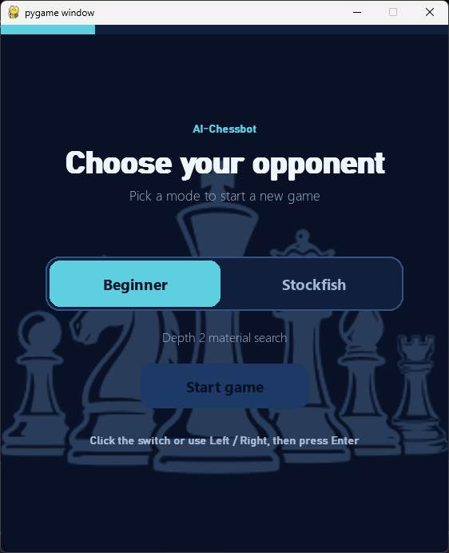
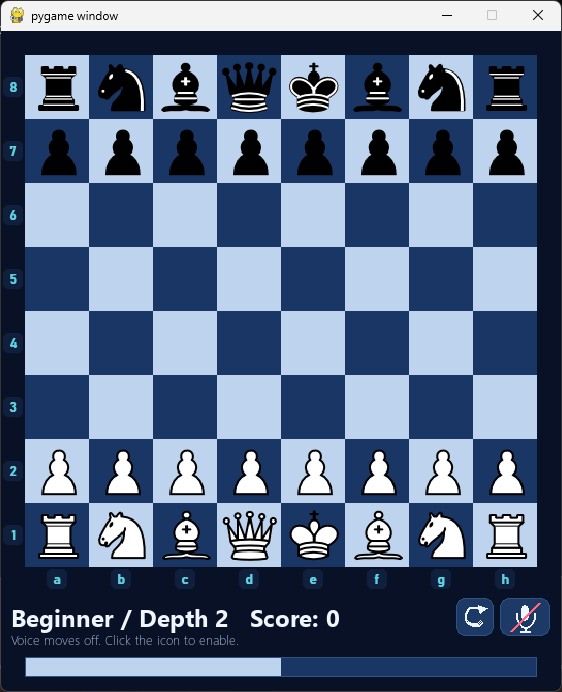
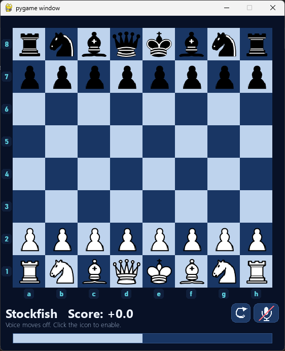
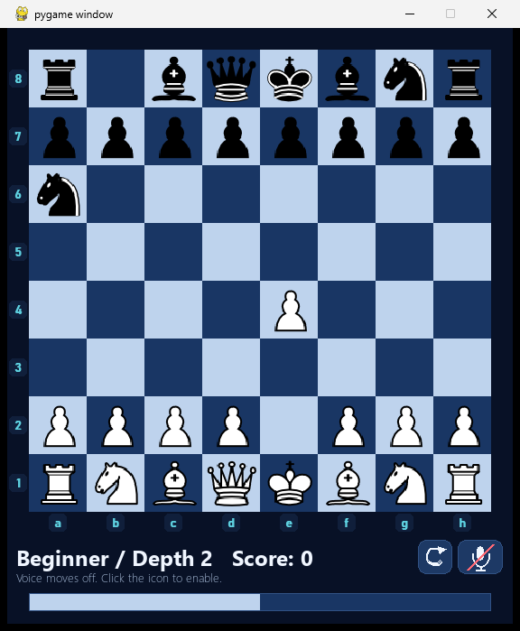
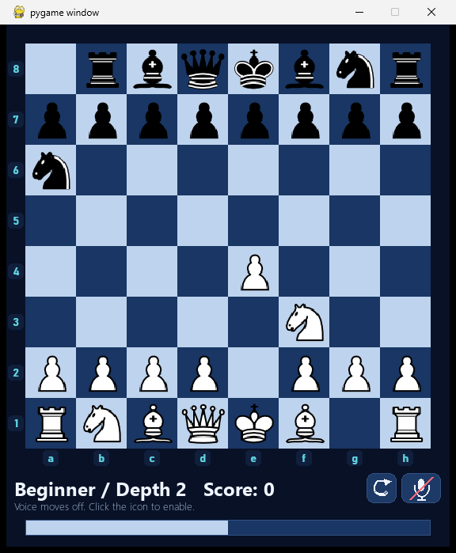

# AI Chessbot

A desktop chess game built with Python and Pygame. Play against a depth-2 minimax opponent or switch to the Stockfish chess engine. The board includes an evaluation bar, optional voice move input, move highlighting.

## Screenshots

### Mode selection



### Beginner mode



### Stockfish mode



## Gameplay progression

These screenshots show a sample opening against the beginner opponent:

### 1. e4 Na6



### 2. Nf3 Rb8




## Features

- **Beginner:** play against the built-in minimax search at depth 2.
- **Stockfish:** play against a locally installed Stockfish engine.
- **Voice moves:** enable or disable the microphone during a game and speak a move using board coordinates, such as "e two to e four," or a piece and destination, such as "knight f three."
- **Chess rules:** legal move validation, castling, en passant, and automatic queen promotion.
- **Board tools:** file and rank labels, a persistent evaluation bar, a restart button, and score display.

## Installation

From PowerShell, run these commands in the project folder:

```powershell
py -m venv .venv
.\.venv\Scripts\python.exe -m pip install -r requirements.txt
```

## Start the game

```powershell
.\.venv\Scripts\python.exe ChessMain.py
```

On the selection screen, click a mode and choose **Start game**. You can also use the left and right arrow keys to select a mode, then press Enter.

During a game, click a piece and then its destination square to make a move. Press **R** or click the reload icon to restart.

## Stockfish setup

```powershell
$env:STOCKFISH_EXECUTABLE = "C:\path\to\stockfish.exe"
.\.venv\Scripts\python.exe ChessMain.py
```

## Voice move setup

Voice input uses Groq's `whisper-large-v3-turbo` transcription model. It requires a Groq API key, an internet connection, and a working microphone. Create an API key in [Groq Console](https://console.groq.com/keys), then set it in the PowerShell session used to start the game:

```powershell
$env:GROQ_API_KEY = "gsk_your_key"
.\.venv\Scripts\python.exe ChessMain.py
```

## Dependencies

Python packages are listed in [`requirements.txt`](requirements.txt).
